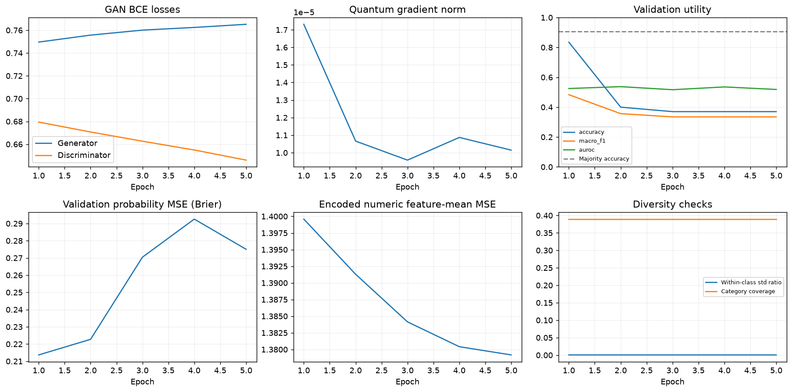
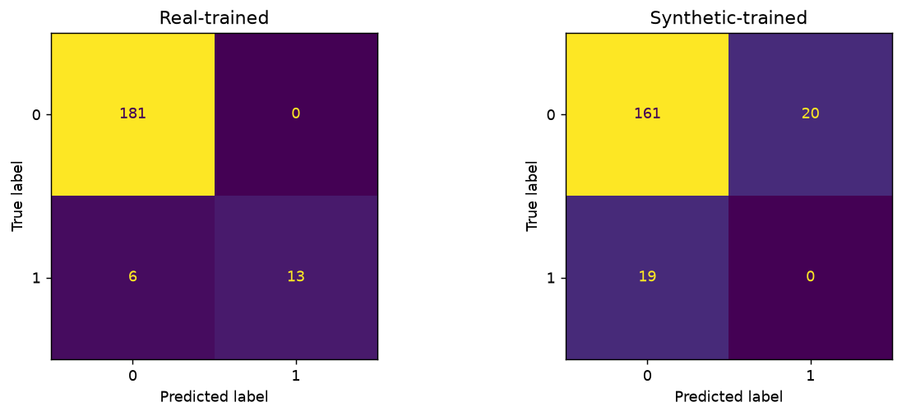
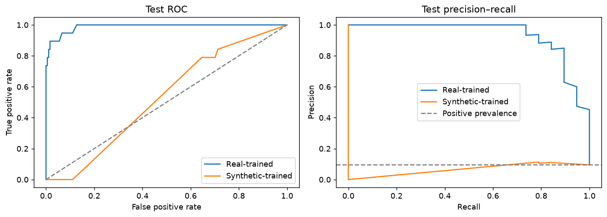
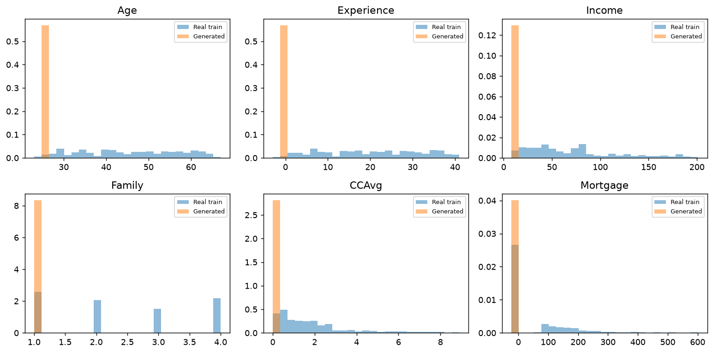
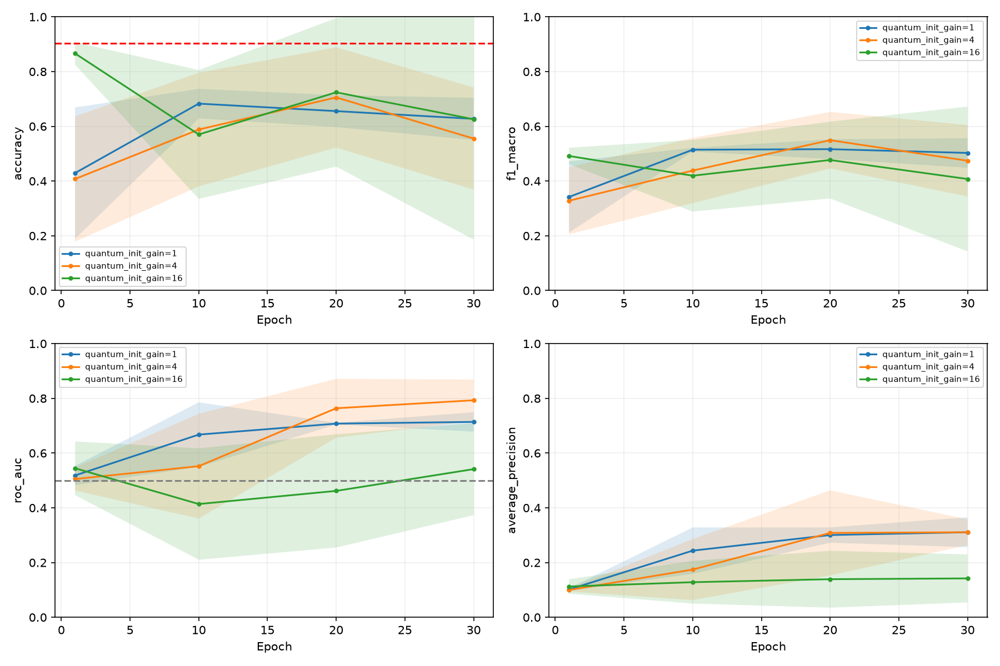

# Meeting guide: how the script works and how to read our diagnostics

**You do not need to rerun training before the meeting.** The notebook already contains executed outputs. Read the short explanation first, then open the four priority figures below.

## What to say in one minute

> We are trying to generate realistic rows of bank data. Our generator combines a quantum circuit with a normal neural network called the mapper. A discriminator learns to tell real and generated rows apart. We then train a separate Random Forest on generated rows and test it on held-out real rows. That Random Forest produces our accuracy, F1 and AUC numbers. Our main problem is collapse: generated rows within a class are much too similar. The recent initialization change improved several prediction metrics and increased variation, but it did not solve collapse or training instability.

**Keep two experiments separate:**

| | Teaching notebook | Recent improvement experiment |
| --- | --- | --- |
| Purpose | Understand every step | Compare a specific model change |
| Data | 1,000 sampled Loan rows | All 5,000 Loan rows |
| Training/validation/test | 600 / 200 / 200 | 3,000 / 1,000 / 1,000 per seed |
| Epochs | 5 | 30 |
| Seeds | 42 | 42, 43, 44 |
| Circuit | Original paper-based circuit | Same two-layer final-H readout circuit in both compared variants |
| Classical hidden widths | Mapper (32,32), discriminator (32,16) | Mapper (128,128), discriminator (128,64,32) |
| Initialization | Gain 1 | Gains 1, 4 and 16 |

**The teaching run's 80.5% accuracy and the new experiment's 77.0% are not directly comparable.** They use different training budgets and networks. The valid before/after comparison for the new experiment is 69.4% versus 77.0% within its matched protocol.

## Four figures to open first

1. [Teaching learning dashboard](outputs/demo/learning_dashboard.png): losses, gradients, validation scores and diversity together.
2. [Generated versus real distributions](outputs/demo/generated_vs_real.png): shows why the generated data is still poor.
3. [Teaching test confusion matrices](outputs/demo/test_confusion_matrices.png): shows the mistakes hidden by accuracy.
4. [Actual improvement comparison](../results/quantum_initialization_study/analysis_all_gains/validation_curves.png): compare the candidate with its matched control.

## 1. What `run_notebook.py` actually does

[run_notebook.py](run_notebook.py) is an **execution wrapper**. The experiment is written in [QTabGAN_step_by_step.ipynb](QTabGAN_step_by_step.ipynb); the training implementation is [QTabGAN.fit()](../qtabgan/model.py).

The wrapper:

1. Reads the notebook file as JSON. A notebook contains Markdown explanations, code cells and saved outputs.
2. Goes through code cells in order, skipping Markdown.
3. Runs ordinary Python using `compile()` and `exec()` in one shared dictionary. Variables such as `data`, `model` and `x_train` remain available to later cells.
4. Captures printed text and errors. The notebook's `table()` and `picture()` functions also send tables and PNG images back to the wrapper through `_emit_display`.
5. Assigns execution numbers and stores these outputs inside the notebook.
6. If a cell fails, stops, records the traceback, saves the partial notebook and exits with failure.
7. Writes the executed notebook through a temporary file and replaces the output file when the write completes.

It is **not a Jupyter server/kernel**. It lets us execute this plain-Python lesson without installing Jupyter. You can also open the same notebook interactively with a Python kernel.

```bash
# Run from the project root. This replaces the teaching outputs, not research results.
MPLCONFIGDIR=/tmp/qtabgan-mpl .venv/bin/python simple_walkthrough/run_notebook.py
```

By default, the wrapper updates the notebook itself. `--output another.ipynb` changes where the executed notebook is saved; the lesson's plot/CSV folder still remains `simple_walkthrough/outputs/demo/`.

## 2. The full chain, in order

```text
Real CSV -> select demonstration rows -> train / validation / test split
                     |
                     +-> fit encoder ONLY on training rows

Training real features -> encoder -> discriminator's real examples
Random angles -> quantum probabilities + requested class -> mapper -> fake examples
                                               |
                         adversarial training updates circuit, mapper and discriminator
                                               |
                       generated rows + requested labels -> train Random Forest
                                               |
Real validation features -> fitted encoder -> Random Forest -> select best GAN epoch
Real test features       -> fitted encoder -> selected Random Forest -> final scores
```

A requested class label is not proof that a generated row actually resembles that class. That is one reason we evaluate on real rows.

### The notebook's 17 code cells

These are execution numbers, not the notebook's Markdown section numbers.

| Cell | What happens | What we verify/save |
| --- | --- | --- |
| 1 | Imports libraries, locates the project, sets seed 42, defines table/plot display helpers | Outputs stay inside `outputs/demo/`; CPU simulation |
| 2 | Reads prepared Loan CSV, samples 1,000 rows with class proportions retained | Missing values, target mapping, numeric/category lists |
| 3 | Splits into 600 training, 200 validation and 200 test rows | No overlapping indices; exact original CSV row IDs saved |
| 4 | Describes and plots real training features | Ranges, histograms, correlations |
| 5 | Fits numeric scaling and categorical encoding on training rows only | Finite values, ranges, one-hot groups, unseen categories; fitted statistics unchanged after held-out transforms |
| 6 | Creates the actual shared QTabGAN model | Parameter counts and network structure |
| 7 | Feeds random angles through the quantum circuit and draws it | 256 nonnegative probabilities summing to one |
| 8 | Follows values through each Linear/ReLU layer | Shapes, min/max, finite activations and fraction of zeros |
| 9 | Applies a small Hadamard matrix example | H creates equal measurement probabilities; H twice restores the input |
| 10 | Calculates D/G losses on eight examples; computes gradients without updating weights | Per-example BCE contributions match the aggregate loss; quantum gradient is finite and nonzero |
| 11 | Fits a reference Random Forest on real training rows | Reference validation scores and majority-class accuracy |
| 12 | Trains five epochs, generates data after each, fits a synthetic-trained Random Forest | Training log, validation scores, diversity and best weights selected by validation macro F1 |
| 13 | Plots the learning dashboard | Inspect competition, useful learning and collapse together |
| 14 | Restores selected weights and evaluates the two classifiers on test rows | Final metrics, confusion matrices, ROC/PR and prediction CSV |
| 15 | Inspects selected generated rows in original feature units | Distributions, range failures, category coverage, correlations |
| 16 | Follows one already-tested row through the final classifier | Actual probability, prediction and observed label |
| 17 | Saves configuration, source/data hashes, versions and summary | Audit trail; optionally displays a separate retained CTGAN report |

### Numbers and shapes you can explain

For this saved teaching run:

- **600 training rows** produce **289 encoded features per row**. One-hot width depends on training categories; it is not always 289 in other runs.
- The quantum circuit takes **8 random angles**, not 289 real-data values.
- Its output has **256 probabilities**. Appending a two-number class indicator gives the mapper **258 inputs**.
- Mapper: `258 -> 32 -> 32 -> 289`.
- Conditional discriminator: `289 features + 2 class indicators -> 32 -> 16 -> 1 logit`.
- Quantum parameters: **32**. Mapper parameters: **18,881**. Discriminator parameters: **9,889**. Much of this hybrid model is classical.
- Batch size 64 gives **10 minibatches per epoch** for 600 rows. Five epochs give **50 discriminator and 50 generator optimizer steps**.
- The configuration shows `epochs=1` because each `fit()` call trains one epoch. The notebook calls it five times, retaining Adam's state.

The original circuit's final eight RZ angles are ineffective for probability output. The optional final-H readout fixes that in the research variant; the teaching notebook deliberately shows the original circuit.

## 3. Training, validation, testing and prediction are different

| Stage | Allowed work | What must not happen |
| --- | --- | --- |
| Training | Fit the encoder; update GAN weights; fit classifiers | Borrow labels or fitted statistics from validation/test |
| Validation | Compare checkpoint utility and choose highest macro F1 | Update weights or refit preprocessing using these rows |
| Testing | Report the frozen selection's results | Use test performance to choose the epoch |
| Prediction | Encode a new row with the fitted encoder and call the trained Random Forest | Refit the model using that row |

The lesson selects **epoch 1**, not epoch 5: later validation macro F1 was worse. The real-trained reference is a comparison, not the generator's objective. Test results are calculated only after checkpoint selection.

The research studies have repeatedly used the same splits, so their scores are exploratory, not fresh independent confirmation.

## 4. Diagnostic plot catalogue: what to read and what to debug

### A. Check data and encoding first

| Plot/check | How to read it | Warning sign | What to inspect next |
| --- | --- | --- | --- |
| [Class balance](outputs/demo/class_balance.png) | Counts of each label in train/validation/test | Rare positive class; missing class; unexpected imbalance between splits | Stratification and label mapping; compare accuracy with the majority baseline |
| [Input histograms](outputs/demo/input_histograms.png) | X = feature value; Y = number of training rows | Extreme tails, impossible values, odd constants or identifier-like columns | Source CSV, column types and clipping decisions |
| [Input correlations](outputs/demo/input_correlations.png) | Red/blue indicates positive/negative numeric correlation; diagonal is 1 | Unexpected relationships or constant columns | Data parsing, feature definitions; correlation is not causation |
| [Encoding checks](outputs/demo/encoding_checks.csv) | Training category counts and unseen-category fractions | Wrong column treated as numeric/category; many unknown values | Explicit categorical list and encoder fitted on training only |
| [One raw-to-encoded row](outputs/demo/one_row_numeric_encoding.csv) | Same numeric values before/after scaling | NaN/Inf; implausible scaling; target accidentally included as a predictor | Train percentiles and [fitted statistics](outputs/demo/fitted_numeric_parameters.csv) |

The teaching run has **272 training ZIP categories**; **28.5%** of validation rows have unseen ZIP codes. Those groups become all zero. This is an observable limitation of a small training subset, not a reason to fit the encoder on validation rows.

### B. Check the quantum and internal numerical path

| Plot/check | How to read it | Warning sign | What it establishes |
| --- | --- | --- | --- |
| [Circuit diagram](outputs/demo/training_circuit.png) | Wires, gate order, rotations, entanglers and measurement | Wrong gates, wires, layers or readout | Which circuit was actually used; not data quality |
| [Quantum probabilities](outputs/demo/quantum_probabilities.png) | Bars are the top 10 bitstring probabilities for one input | Nonfinite/negative values or full vector not summing to 1 | Probability validity; top 10 alone need not sum to 1 |
| [Quantum gradient heatmap](outputs/demo/initial_quantum_gradients.png) | Magnitude of derivative per angle and layer | All useful gradients zero or nonfinite | Whether a training signal reaches the circuit; nonzero does not prove useful learning |
| [Internal layer checks](outputs/demo/internal_layer_checks.csv) | Layer shapes, ranges and zero fractions | Unexpected width, NaN/Inf or a persistently all-zero hidden layer | Where a numerical/activation problem appears |

Zero final-RZ gradients are expected in the original circuit; a zero parameter is not automatically a software bug. ReLU also produces zeros by design. Look for whole-layer failure and compare against the intended architecture.

### C. Check the learning process



Read this dashboard left-to-right, top-to-bottom:

1. **GAN BCE losses:** G tries to fool D; D tries to distinguish real/fake. Falling D loss with rising G loss can mean D finds the task easy. There is no single loss level that proves good generated data. Both losses near 0.693 can also mean neither side learned.
2. **Quantum gradient norm:** verifies updates can reach quantum angles. Nonfinite values suggest instability; zero gradients need investigation. Larger gradients are not automatically better.
3. **Validation accuracy/F1/AUROC:** usefulness of a Random Forest trained on fake data. The dashed majority-accuracy line prevents a misleading accuracy claim.
4. **Brier MSE:** `mean((predicted_positive_probability - true_label)**2)`. Lower is better. It measures probabilistic prediction error, not the generator's training objective. Calibration and discrimination can both affect it.
5. **Feature-mean MSE:** compares encoded numeric column means. Lower means the averages are closer, not that distributions match. Generating the mean repeatedly can score well here. Units are squared encoded coordinates, not dollars or years.
6. **Diversity:** within-class spread and category coverage. A nearly zero spread ratio signals collapse even when losses or feature means look better.

Our feature-mean MSE decreases during this lesson while validation performance and diversity remain poor. That is why we need several diagnostics rather than one attractive line.

The two optimized losses are:

```text
D loss = [BCE(D(real, class), target=1) + BCE(D(fake, class), target=0)] / 2
G loss = BCE(D(fake, class), target=1)
```

D emits logits; BCEWithLogitsLoss applies the sigmoid safely inside the loss. Adam updates the parameters using gradients at learning rate 0.0002 for each side. The [eight-example loss table](outputs/demo/one_batch_losses.csv) lets you check contributions before any optimizer step. Its first example has D loss contribution about **0.67966** and G contribution **0.74211**; column means reproduce the cell's full-batch losses.

### D. Check prediction errors, especially the rare class



Rows = true class; columns = predicted class. Class 1 is the positive Loan label.

For the **synthetic-trained** classifier:

| | Predicted 0 | Predicted 1 |
| --- | ---: | ---: |
| Actual 0 | 161 correct negatives | 20 false positives |
| Actual 1 | 19 missed positives | 0 correct positives |

Accuracy is **161/200 = 80.5%**, but it misses **all 19 positive cases**. Always predicting 0 gets **181/200 = 90.5%**. The 80.5% is not success.

The real-trained reference has matrix `[[181, 0], [6, 13]]` and accuracy **97.0%**. This shows the same features/evaluator can support useful prediction; it does not by itself identify the generator's exact failure.



- **ROC:** X = false-positive rate, Y = true-positive rate as the classification threshold changes. AUROC around 0.5 is chance ranking; nearer 1 is better.
- **Precision–recall:** precision asks “of the predicted positives, how many are really positive?” Recall asks “of all actual positives, how many did we find?” It is particularly informative with rare positives.
- **Average precision (AP):** summarizes precision–recall performance. Compare with positive prevalence, **9.5%** here; AP is not accuracy and is not the same as trapezoidal PR area.
- **Macro F1:** averages the two classes' F1 scores equally, preventing the large class from completely dominating the summary.

Teaching synthetic-trained scores: **macro F1 0.4460; AUROC 0.5288; AP 0.1105; Brier MSE 0.22385**. Real-trained Brier MSE is **0.03101**. The small ranking signal does not fix the thresholded prediction failures above.

Underlying labels and probabilities: [test_predictions.csv](outputs/demo/test_predictions.csv). You can recompute the metrics instead of trusting the pictures.

### E. Check realism and collapse directly



X = original feature units; Y = density. Overlapping broad shapes support a distribution match. A thin generated peak while the real values are spread out indicates collapse. Large shifts or values outside sensible ranges suggest decoding/output problems.

Examples from the teaching run:

- Age standard deviation: **11.65 real**, **0.035 generated**.
- Income standard deviation: **47.79 real**, **0.037 generated**.
- Generated Mortgage values are all below the observed training range.
- Generated ZIP codes use **1 of 272** training categories.

See [raw numeric checks](outputs/demo/raw_numeric_diagnostics.csv) and [category coverage](outputs/demo/category_coverage.csv). The mean minimum within-class spread ratio is approximately **0.054%** of real variation. This averages the smaller class-specific ratio per numeric feature; it does not say every class-feature ratio has that value.

A ratio near 1 alone is not sufficient either: the mean, shape, category relationships and tails can still be wrong. Category coverage also misses whether frequencies match. Our coverage summary averages features equally, so inspect ZIP separately rather than assuming a 39% average means 39% of all ZIP categories are represented.

[Correlation comparison](outputs/demo/correlation_checks.png) shows real, generated and absolute-error matrices. Error near 0 means similar correlations; large error means lost relationships. Blank cells indicate undefined correlations, often from constant columns. Correlation can be unstable when variation is tiny, and matching correlation alone cannot establish realism.

[An example CDF plot from the research candidate](../results/quantum_initialization_study/runs/gain_4/seed_42/test/best/cdf.png) is another distribution check: X = encoded value, Y = fraction of rows at or below that value. Separated curves reveal shifts; a sharp jump reveals concentration. Those plots use clipped/re-encoded values, so use raw histograms and range checks alongside them. This example is **not from the teaching run**.

## 5. How the final prediction works

```text
Already-prepared real row -> training-fitted encoder -> selected Random Forest
                         -> probability of class 1 -> predicted label
```

There is no quantum circuit call at this point. The quantum generator was used earlier to make the Random Forest's training rows.

Saved example: original CSV row **4648**, observed class **0**. The synthetic-trained classifier estimates class-1 probability **0.49**, so it predicts **0**. That probability is a classifier estimate, not a bitstring probability and not D(real/fake). This reuses an already-tested row to illustrate inference; it is not a new independent evaluation.

## 6. Actual model-improvement evidence: a separate experiment



The recent change initializes the mapper's first layer to amplify quantum-probability variation around a calibrated mean. It preserves that first layer's response at the mean. It changes neither the architecture nor the adversarial loss; the paper does not specify a classical initialization recipe. Calibration uses random latent inputs, not held-out data.

Mean test scores across three seeds, with checkpoints chosen by validation macro F1:

| Diagnostic | Gain 1 baseline | Gain 4 candidate | Interpretation |
| --- | ---: | ---: | --- |
| Accuracy | 69.4% | 77.0% | Improved, but below 90.4% majority accuracy |
| Macro F1 | 0.5453 | 0.6013 | Improved balanced class performance |
| AUROC | 0.7428 | 0.7923 | Improved ranking |
| AP | 0.3701 | 0.3563 | Slightly worse; not all metrics improved |
| Mean minimum within-class std ratio | 0.257% | 1.259% | About 4.9× more spread, still severely collapsed |
| Raw numeric KS | 0.6137 | 0.5975 | Slightly closer numeric distributions; lower is better |

[Full evidence](../results/quantum_initialization_study/analysis_all_gains/REPORT.md) · [Loss curves](../results/quantum_initialization_study/analysis_all_gains/loss_curves.png) · [Diversity checks](../results/quantum_initialization_study/analysis_all_gains/diversity_checks.png)

The fixed final-epoch macro F1 was worse for gain 4 than for its control. This is an early-checkpoint candidate, not a stable overall improvement or reproduced paper result. The teaching notebook keeps gain 1.

The [earlier discriminator-confidence audit](../results/training_balance_audit/discriminator_confidence.png) found mean real-validation probability near 0.983 and fake probability near 0.022 at final 100-epoch checkpoints. That motivated a rate test; it did not prove the rate was the cause. Faster G later reached **90.4% accuracy with AUROC 0.5**—a rejected majority-class collapse. This is the clearest example of why we inspect multiple diagnostics.

## 7. A practical debugging order

1. **Check data and labels:** right columns, no accidental ID/target predictor, known missing-value policy, class counts.
2. **Check isolation:** disjoint row IDs; encoder fit only on train; no test-based epoch selection.
3. **Check shapes and finite values:** encoded dimensions, class vectors, probability sums, layer outputs.
4. **Check gradients and updates:** useful quantum parameters receive finite gradients; weights actually change.
5. **Check training competition:** D's real/fake confidence and both losses. These suggest hypotheses, not a proven fix.
6. **Check usefulness:** validation macro F1, AUROC, AP and confusion counts; compare with simple references.
7. **Check realism:** raw distributions, per-class spread, category coverage/frequencies and correlations.
8. **Change one factor:** keep seeds, splits and other settings fixed; report successes and failures. Select using validation, then report testing.

The notebook verifies numerical execution. The diagnostics determine whether that numerically working program produces a useful model. Those are different questions.

## Questions you should be ready to answer

**Why a quantum circuit?** It is the probability-generating component of the paper's hybrid generator. Our results do not establish quantum advantage.

**Why not just train longer?** Our 100-epoch curves often deteriorated. More epochs are not a solution by themselves.

**Does nonzero gradient mean the model learns good data?** No. It only verifies a path for parameter updates.

**Why did we change the mapper initialization?** The audit showed quantum probabilities changed with noise while mapped rows barely changed. We tested amplifying that variation, then checked useful scores and diversity.

**Why don't we use row-by-row MSE?** A generated customer is not a reconstruction of a particular real customer. Arbitrarily pairing them gives a misleading reconstruction score.

**Have we reproduced the paper?** No. Author settings remain incomplete; data/split/evaluator choices and analytic sampling differ, and collapse remains.

**What are we doing next?** Preserve the baseline and verify whether the gain-4 candidate's improvements survive a longer matched run. Continue judging diversity and rare-class prediction alongside accuracy; do not promise a better circuit or successful hardware run yet.

[Notebook](QTabGAN_step_by_step.ipynb) · [Paper settings](PAPER_SETTINGS.md) · [Team ownership/evidence log](TEAM_TASKS.md) · [Output index](outputs/demo/README.md)
